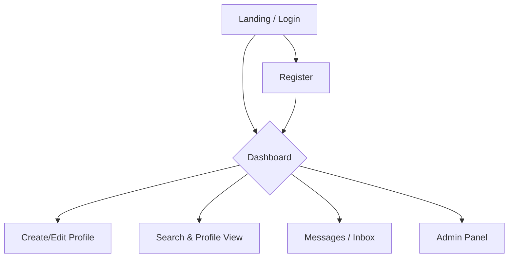

# Tamil Nadu Matrimonial Website

**Goal:** Build a professional, trustworthy matrimonial website focused on Tamil Nadu users. Support registration and matching for brides and grooms, profile management, search/matching, messaging, admin moderation, payments (premium features), and analytics.

## MVP User Flow

## Current Project Status

This is a Flutter web application for a Tamil Nadu matrimonial service.

- **Backend:** The project is actively using Supabase for its backend, including user authentication and database operations on the `profiles` table.
- **UI Framework:** The application is built using Flutter, with a clear separation of pages, widgets, and localization files.
- **Localization:** The project is set up for both English and Tamil languages.
- **Data:** The UI is now driven by dynamic data from the Supabase backend, replacing the initial static dummy data. The core MVP flow for profile management is functional.

### Recent Updates (October 2025)

- **Home Page Match Feature (October 18, 2025):**
    - Replaced the "I'm looking for" section on the user dashboard with a new match-finding feature.
    - Added "Girl Nachatram" and "Boy Nachatram" dropdowns with options in Tamil to allow users to find matches based on astrological signs.
    - **Error Fixes:**
        - Resolved errors in `profile_view_page.dart` and `user_dashboard_page.dart` that arose from the removal of the `religion` field.

- **Replaced Religion with Astrological Info (October 17, 2025):**
    - Replaced the "Religion" field with "Rasi" and "Nachathram" across the application to better suit the matrimonial context.
    - **Database:** Updated the `profiles` and `preferences` tables in Supabase to remove the `religion` column and add `rasi` and `nachathram` columns.
    - **Data Model:** Modified the `Profile` class in `lib/main.dart` to reflect the database changes.
    - **UI Updates:**
        - Updated the registration (`register_page.dart`) and profile editing (`create_edit_profile_page.dart`) forms to include dropdowns for "Rasi" and "Nachathram" with options in Tamil.
        - Reordered the dropdowns to "Mother Tongue", "Rasi", and "Nachathram" for a better user flow.
    - **Bug Fixes:**
        - Resolved errors in `profile_view_page.dart` and `user_dashboard_page.dart` that arose from the removal of the `religion` field.
- **Implemented "Edit Profile" MVP:**
    - Users can navigate from their dashboard to a comprehensive "Create/Edit Profile" page.
    - The form is pre-populated with the user's current data fetched from the Supabase `profiles` table.
    - All fields on the form, including personal details, location, education/career, and family information, can be updated and saved back to the database.
- **Backend Integration:**
    - The `user_dashboard_page.dart` now fetches the complete user profile.
    - The `create_edit_profile_page.dart` handles both creating a new profile and updating an existing one.
- **Bug Fixes:**
    - Resolved a critical runtime crash on the "Edit Profile" page caused by `DropdownButtonFormField` when handling profiles with incomplete (`null`) data. The form is now more robust.

### Implemented Pages

The following pages have been created as part of the initial UI development:

-   **Home Page:** The main landing page with a search form, featured profiles, and general information.
-   **Login Page:** For user authentication.
-   **Register Page:** For new user registration.
-   **Create/Edit Profile Page:** For users to create and manage their profiles.
-   **Search Results Page:** To display profiles based on search criteria.
-   **Profile View Page:** To view the details of a single profile.
-   **User Dashboard Page:** The main dashboard for logged-in users.
-   **Admin Panel Page:** For administrators to manage the platform.
-   **Public Pages:**
    -   About Us
    -   FAQ
    -   Privacy Policy
    -   Terms & Conditions
    -   Contact Us